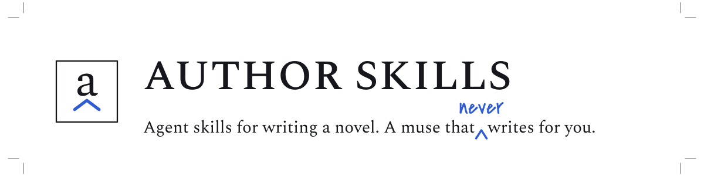
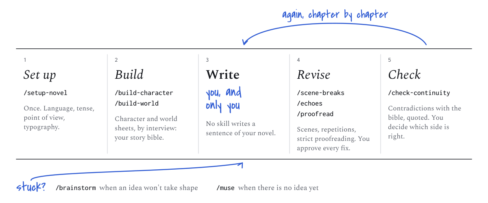
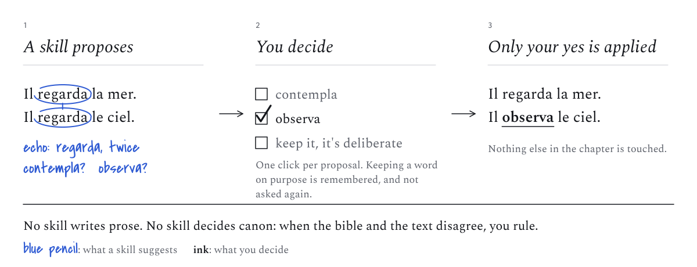

<p align="center">
  <picture>
    <source media="(prefers-color-scheme: dark)" srcset="docs/images/banner-dark.svg">
    
  </picture>
</p>

You write your novel. These skills help an AI agent (Claude Code, or any
coding agent) do everything around the writing: proofread strictly, spot
repetitions and badly placed scene breaks, build your characters and your
world with you, and check that chapter 20 does not contradict chapter 3.

They never write a sentence of your novel, and they never change your text
without your yes.

## What it does for you

**Before you write**

- [setup-novel](skills/setup-novel/SKILL.md): tells the agent how your
  novel works, once: language, tense, point of view, typography.
- [build-character](skills/build-character/SKILL.md): builds a character
  sheet by interviewing you: body, psychology, what they know and can do,
  how they behave, voice, relationships, arc.
- [build-world](skills/build-world/SKILL.md): the same for places, from a
  building to a whole world, and for systems: magic, factions, religions...

**When you revise**

- [scene-breaks](skills/scene-breaks/SKILL.md): checks where your chapters
  break into scenes, and where a break is missing or cuts a scene in two.
- [echoes](skills/echoes/SKILL.md): finds repeated words, tics and weak
  verbs, and offers words to choose from. It never rewrites your sentence.
- [proofread](skills/proofread/SKILL.md): strict proofreading (spelling,
  grammar, conjugation, tenses, punctuation, typography). No opinions on
  style.
- [check-continuity](skills/check-continuity/SKILL.md): finds
  contradictions between chapters, or between the text and your notes,
  each with quotes. You decide which side is right.

**When you are stuck**

- [brainstorm](skills/brainstorm/SKILL.md): when an idea will not take
  shape, it asks questions until the idea holds, then writes it down as a
  brief.
- [muse](skills/muse/SKILL.md): when there is no idea at all, one-line
  sparks drawn from your own story: a question, a constraint, a "what if".

## How you work with it

<p align="center">
  <picture>
    <source media="(prefers-color-scheme: dark)" srcset="docs/images/workflow-dark.svg">
    
  </picture>
</p>

1. `/setup-novel`, once: layout, language, tense, point of view,
   typography, Grammalecte.
2. `/build-character` and `/build-world` as the story needs them.
3. Write.
4. `/scene-breaks <chapitres>`, `/echoes <chapitres>` and
   `/proofread <chapitres>`: reports, then validated corrections.
5. `/check-continuity [axes] [chapitres]`: extract, compare, verify,
   arbitrate.
6. When stuck: `/brainstorm <idée>` if an idea will not take shape,
   `/muse` if there is no idea.

## You stay the author

<p align="center">
  <picture>
    <source media="(prefers-color-scheme: dark)" srcset="docs/images/golden-rule-dark.svg">
    
  </picture>
</p>

Every change to your manuscript is shown to you first, with the exact
words before and after, and applied only once you have said yes. A word
you keep on purpose is remembered and not raised again. When your notes
and your text disagree, neither wins: you rule, and your ruling is kept.

These rules are not settings that can be turned off:
[files are the contract](docs/adr/0001-files-are-the-contract.md),
[the author rules on canon](docs/adr/0002-the-author-rules-on-canon.md),
[invariants](docs/adr/0003-invariants.md).

## Getting started

You need [Claude Code](https://claude.com/claude-code), or another coding
agent, and a folder for your novel, with one Markdown file per chapter.
`proofread` also uses [Grammalecte](https://grammalecte.net), a French
grammar checker; `/setup-novel` checks it with you.

**Claude Code: as a plugin.** Skills are namespaced `author-skills:<name>`.

```
/plugin marketplace add Birdiz/author-skills
/plugin install author-skills@birdiz-author
```

**Other agents, or to edit the skills:** copy the folders under `skills/`
into the agent's skills directory.

Then open your novel's folder with the agent and run `/setup-novel`.

## Status

Early. `setup-novel`, `proofread`, `scene-breaks` and `echoes` have run on
a real manuscript, and the [changelog](CHANGELOG.md) records what those
runs changed; the other skills are still first versions. Grammalecte's
command line is used through the flags its documentation lists, confirmed
by `setup-novel` on the author's machine.

---

## Under the hood

Small, composable, and readable by any coding agent. The structure follows
[mattpocock/skills](https://github.com/mattpocock/skills): user-invoked
skills orchestrate, model-invoked skills hold the discipline, and a shared
vocabulary ([CONTEXT.md](CONTEXT.md)) keeps them speaking the same language.

### The novel project

The skills work in the novel's own repository, never in this one:

```
<novel>/
├── NOVEL.md                 # setup-novel
├── manuscript/              # one Markdown file per chapter, one paragraph per line
│   ├── 01-<titre>.md
│   └── ...
├── bible/                   # story-bible
│   ├── LEXICON.md
│   ├── characters/
│   ├── world/places/
│   ├── world/systems/
│   ├── timeline.md
│   └── rulings.md
├── .continuity/             # check-continuity: facts cache, findings
├── .proofread/              # proofread: reports, deliberate forms
├── .scenes/                 # scene-breaks: reports, deliberate breaks
├── .echoes/                 # echoes: reports, deliberate motifs
└── notes/                   # brainstorm briefs, muse sparks
```

### Skills

**User-invoked** (they orchestrate): the nine skills above.

**Model-invoked** (they hold the discipline)

- [story-bible](skills/story-bible/SKILL.md): bible layout, sheet
  templates, lexicon, timeline, rulings, annotations, the canon rule.
- [grilling](skills/grilling/SKILL.md): the interview in rounds, in ask or
  suggest mode.
- [continuity-findings](skills/continuity-findings/SKILL.md): the format of
  a contradiction.
- [validated-corrections](skills/validated-corrections/SKILL.md): how a
  change to the manuscript is proposed, validated by the author and
  applied.

A user-invoked skill may rely on model-invoked ones, never on another
user-invoked one.

### Decisions

- [0001](docs/adr/0001-files-are-the-contract.md): files are the contract
  between skills.
- [0002](docs/adr/0002-the-author-rules-on-canon.md): the author rules on
  canon.
- [0003](docs/adr/0003-invariants.md): invariants are not configurable
  (no prose, validated corrections only, no style in proofreading, quotes
  in every finding).

### Tests

The scripts' tests run with the standard library:
`python3 -m unittest discover tests`.

### Images

The README images are drawn by [docs/images/build.py](docs/images/build.py);
see [docs/images/README.md](docs/images/README.md) to change them.

### Releases

Bumping `version` in `.claude-plugin/plugin.json` on `main` releases it:
the [release workflow](.github/workflows/release.yml) runs the tests, then
tags `v<version>` and publishes a GitHub Release whose notes are that
version's `CHANGELOG.md` entry. A version without an entry fails the
workflow. A version that already has a tag is skipped, and the workflow
can be run by hand to release the current version.

### Language

Skills are written in English. Templates, questions and everything the
author reads are in French, the language of the novels this set was written
for; skills translate the templates when `NOVEL.md` declares another
language.

### License

MIT.
